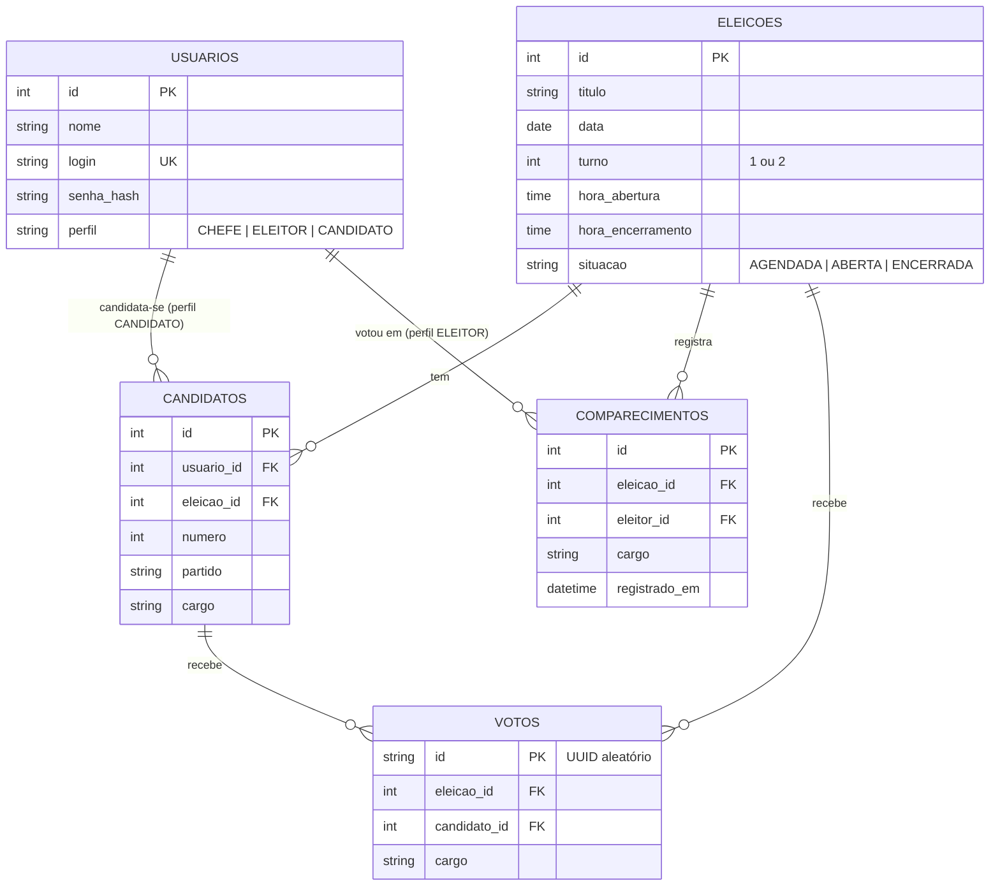

# Eleição Eletrônica — Back-End (FastAPI)

API do Sistema de Simulação de Eleição Eletrônica. Python 3.11+, FastAPI, SQLAlchemy 2, SQLite, JWT.

## Executar

```bash
python -m venv .venv
source .venv/bin/activate          # Windows: .venv\Scripts\activate
pip install -r requirements.txt

python -m scripts.popular_demo      # dados de demonstração, caso deseje
uvicorn app.main:app --host 0.0.0.0 --port 8000 --reload
```

- Swagger UI: http://localhost:8000/docs  (ReDoc em `/redoc`)
- Chefe da Seção criado automaticamente: **admin / admin123** (mude com `CHEFE_LOGIN`, `CHEFE_SENHA`).
- Para o app no celular, rode com `--host 0.0.0.0` e use o IP do computador (ex.: `http://192.168.0.10:8000`); libere a porta 8000 no firewall.
- Em Swagger: faça `POST /auth/login`, copie `access_token`, clique em **Authorize**.

Variáveis de ambiente: `DATABASE_URL` (padrão `sqlite:///./eleicao.db`), `SECRET_KEY`, `TOKEN_EXPIRE_MINUTES`.

## Documentação da API

- **Online (GitHub Pages):** https://thiagoportoscarano.github.io/eleicaoEletronica/ — Swagger UI estático, gerado de [`docs/openapi.json`](docs/openapi.json). Com a API rodando em `localhost:8000`, o botão *Try it out* funciona direto da página.
- **Local:** http://localhost:8000/docs (Swagger UI) e http://localhost:8000/redoc, gerados automaticamente pelo FastAPI a partir das rotas e dos schemas Pydantic.
- A especificação sai do próprio código: `python -m scripts.exportar_openapi` reescreve o `docs/openapi.json`. Rode de novo sempre que mudar uma rota ou um schema.

## Coleção do Postman / Insomnia (roteiro da apresentação)

[`docs/eleicao.postman_collection.json`](docs/eleicao.postman_collection.json) tem o roteiro completo, em 9 pastas e 51 requisições: login, eleição, eleitores, candidatos, perfis, votação, acompanhamento e resultado, incluindo os casos de erro de cada regra (401, 403, 409, 422).

1. Suba a API (`uvicorn app.main:app --port 8000`).
2. No Postman: **Import** → escolha o arquivo. No Insomnia: **Import** → *From File* (ele aceita coleções do Postman).
3. Rode a coleção inteira (**Run collection**) ou passo a passo, na ordem. Cada requisição confere o status esperado e guarda tokens e IDs nas variáveis da coleção (`tokenChefe`, `eleicaoId`, ...).

O primeiro passo gera um sufixo para os logins, então a coleção pode ser rodada várias vezes no mesmo banco.

## Testes

```bash
pytest           # 48 testes: unitários (tests/unit) e de integração (tests/integration)
```

- **Unitários** (`tests/unit`): testam funções isoladas, sem HTTP. Hash de senha e token JWT (`security.py`), validação dos schemas e as regras de votação chamando os services direto com uma sessão de banco.
- **De integração** (`tests/integration/test_api.py`): sobem o app inteiro com o `TestClient` e fazem requisições HTTP de verdade, passando por rota → dependência de perfil → service → banco. Cobrem o fluxo completo da eleição, as permissões de cada perfil e o sigilo do voto (inclusive conferindo as colunas das tabelas).
- Os testes usam SQLite em memória e um banco novo por teste (`tests/conftest.py`), então não dependem de ordem nem do `eleicao.db`.

## Arquitetura

API REST em camadas. Cada requisição passa por:

```
cliente (Postman, app, Swagger)
   │  HTTP + JSON, token JWT no cabeçalho Authorization
   ▼
routers/   camada HTTP: rota, código de status, schema de entrada/saída
   │  deps.py: lê o token, carrega o usuário e barra o perfil errado (401/403)
   ▼
services/  regras de negócio, sem nada de HTTP; lançam exceções de exceptions.py
   │
   ▼
models.py  tabelas (SQLAlchemy ORM) ──► SQLite (eleicao.db)
```

- **Routers não têm regra de negócio** e **services não conhecem HTTP**. Um service lança `Conflito("...")`, e o handler único em `main.py` transforma qualquer `ErroNegocio` em `{"detail": ...}` com o status certo. Por isso os services podem ser testados sem servidor.
- **Controle de acesso** fica nas dependências do FastAPI (`usuario_atual`, `somente_chefe`, `somente_eleitor`), declaradas na própria rota. A restrição "candidato só vê o próprio cargo" é de negócio e fica em `services/apuracao.py`.
- **Schemas Pydantic** validam a entrada (422 automático) e definem a saída. Assim a senha nunca volta na resposta, e o Swagger é gerado a partir deles.
- **Configuração** por variáveis de ambiente (`config.py`). Trocar `DATABASE_URL` troca o banco sem mudar código.

## Estrutura modular

```
app/
├── main.py        app, CORS, tratamento de erros, routers
├── config.py      configuração por variáveis de ambiente
├── database.py    engine/sessão SQLAlchemy
├── models.py      tabelas: usuarios, eleicoes, candidatos, comparecimentos, votos
├── schemas.py     contratos de entrada/saída (Pydantic → Swagger)
├── security.py    hash PBKDF2 e JWT
├── deps.py        usuário autenticado + controle por perfil (403)
├── exceptions.py  erros de negócio (401/403/404/409/422)
├── routers/       camada HTTP (auth, eleicoes, eleitores, candidatos, votacao, apuracao)
└── services/      regras de negócio (sem HTTP): usuarios, eleicoes, candidatos, votacao, apuracao
tests/
├── conftest.py        banco em memória por teste + fixtures (chefe, cenário de eleição)
├── unit/              segurança, schemas e services sem HTTP
└── integration/       API completa via TestClient
scripts/
├── popular_demo.py    dados de demonstração
└── exportar_openapi.py  gera docs/openapi.json
docs/
├── index.html         Swagger UI estático (GitHub Pages)
├── openapi.json       especificação da API
└── eleicao.postman_collection.json  roteiro da apresentação
```

Cada módulo de `services/` corresponde a um assunto do minimundo e tem um router com o mesmo nome:

| Módulo | Responsabilidade |
|---|---|
| `usuarios` | login (com tempo constante para login inexistente), Chefe inicial, CRUD de eleitores |
| `eleicoes` | cadastro, alteração enquanto AGENDADA, abertura e encerramento |
| `candidatos` | cadastro do usuário-candidato + candidatura (cargo, número, partido, eleição) |
| `votacao` | candidatos por cargo, registro e confirmação do voto, cargos já votados |
| `apuracao` | contagem parcial e resultado final, com o recorte por cargo para o perfil CANDIDATO |

## Modelagem do banco de dados



| Tabela | O que guarda | Chaves e restrições |
|---|---|---|
| `usuarios` | Chefe, eleitores e candidatos (o `perfil` diz qual) | PK `id`; `login` **único**; senha só como hash PBKDF2 com sal |
| `eleicoes` | data, turno, horários e situação | PK `id`; `turno` 1 ou 2 e encerramento depois da abertura (validados na API) |
| `candidatos` | a candidatura de um usuário a um cargo numa eleição | PK `id`; FK `usuario_id` → `usuarios`, FK `eleicao_id` → `eleicoes`; **único** (`eleicao_id`, `cargo`, `numero`) e (`eleicao_id`, `usuario_id`) |
| `comparecimentos` | **que** um eleitor já votou num cargo, sem dizer em quem | PK `id`; FKs para `eleicoes` e `usuarios`; **único** (`eleicao_id`, `eleitor_id`, `cargo`) = um voto por cargo, garantido pelo próprio banco |
| `votos` | o voto anônimo: eleição, candidato e cargo | PK `id` UUID aleatório; FKs para `eleicoes` e `candidatos`; **sem** eleitor e sem horário; `WITHOUT ROWID` |

Decisões de modelagem:

- **Candidato é um usuário** (para fazer login) **mais uma candidatura** (`candidatos`). Assim o mesmo login pode concorrer em outra eleição (2º turno) sem duplicar a conta.
- **O turno fica na eleição.** O 2º turno é outra linha em `eleicoes`, e por isso "um voto por cargo na eleição e turno" vira a restrição única de `comparecimentos`.
- **`cargo` repetido em `votos` e `comparecimentos`** de propósito: a apuração conta votos por cargo sem precisar de join, e o comparecimento barra duplicidade sem saber o candidato.
- **Enums** (`perfil`, `situacao`, `cargo`) são gravados como texto e validados pela aplicação. A integridade referencial está ligada no SQLite (`PRAGMA foreign_keys=ON` em `database.py`).
- O voto e o comparecimento são gravados **na mesma transação**: ou os dois entram, ou nenhum.

## Endpoints por perfil

| Perfil | Pode |
|---|---|
| público | `POST /auth/login` |
| qualquer logado | `GET /auth/me`, `GET /eleicoes`, `/eleicoes/atual`, `/eleicoes/{id}`, `GET /candidatos` |
| **CHEFE** | `POST/PUT /eleicoes`, `POST /eleicoes/{id}/abrir`, `/encerrar`; CRUD `/eleitores`; `POST/PUT/DELETE /candidatos`; apuração/resultado de todos os cargos |
| **ELEITOR** | `GET /eleicoes/{id}/cargos`, `GET /eleicoes/{id}/meus-votos`, `POST /eleicoes/{id}/votos`; apuração/resultado de todos os cargos |
| **CANDIDATO** | `GET /eleicoes/{id}/apuracao` e `/resultado` **só do próprio cargo** |

Apuração: `GET /eleicoes/{id}/apuracao` (parcial, em tempo real; 409 se AGENDADA). Resultado final: `GET /eleicoes/{id}/resultado` (409 até encerrar; traz o mais votado de cada cargo, `empate: true` quando há empate no topo).

## Regras de negócio implementadas

- Eleição: `AGENDADA → ABERTA → ENCERRADA`, só o Chefe muda; turno 1 ou 2; encerramento depois da abertura; não abre sem candidatos.
- Voto só com eleição **ABERTA**, só **ELEITOR**, **um por cargo** (restrição UNIQUE no banco), exige `confirmado: true` e não pode ser alterado (não existe rota de edição/exclusão de voto).
- Candidatos só são criados/alterados/excluídos enquanto a eleição está AGENDADA; número único por cargo+eleição.
- Chefe cadastra eleitores e candidatos (candidato = usuário com cargo, partido, número e eleição).
- Eleitor que já votou **não pode ser excluído** (409). Apagar o comparecimento deixaria a eleição com mais votos do que eleitores que votaram, e o voto anônimo não pode ser localizado para sair junto.
- **Registrar e confirmar o voto:** a confirmação vai no mesmo pedido (`POST /eleicoes/{id}/votos` com `"confirmado": true`). Sem `confirmado: true` nada é gravado (422). Foi uma escolha para não guardar "votos pendentes": um voto registrado e ainda não confirmado teria que ficar ligado ao eleitor até a confirmação, e isso quebraria o sigilo. A tela de confirmação (mostrar o candidato e pedir "Confirma?") é papel do cliente; a API só grava o que veio confirmado, e depois disso não há rota para alterar.

## Sigilo do voto

`comparecimentos` guarda *que* o eleitor votou no cargo X (barra duplicidade); `votos` guarda eleição + candidato + cargo, com **UUID aleatório e sem eleitor nem horário**. Nenhuma tabela liga eleitor a candidato e nenhum endpoint revela em quem alguém votou (`meus-votos` só lista cargos).

A tabela `votos` é criada como **`WITHOUT ROWID`** no SQLite. Numa tabela comum, o `rowid` crescente guarda a ordem de inserção, e cruzar essa ordem com a de `comparecimentos` revelaria em quem cada eleitor votou. Sem rowid, os votos ficam ordenados só pelo UUID aleatório. Um banco `eleicao.db` criado antes dessa mudança precisa ser apagado e recriado, porque o `create_all` não altera tabelas que já existem.

Testes que garantem o sigilo e o controle de acesso (48 no total): colunas de `votos` e `comparecimentos`, `votos` como WITHOUT ROWID (consulta ao `sqlite_master`), token adulterado/expirado → 401, ELEITOR e CANDIDATO fora das rotas do Chefe e da votação → 403, CANDIDATO só vê o próprio cargo na apuração e no resultado.

## Erros

Formato `{"detail": "mensagem"}`: 401 credencial/token inválido, 403 perfil sem permissão, 404 não encontrado, 409 conflito (eleição não aberta, voto duplicado, login/número repetido), 422 dados inválidos.

