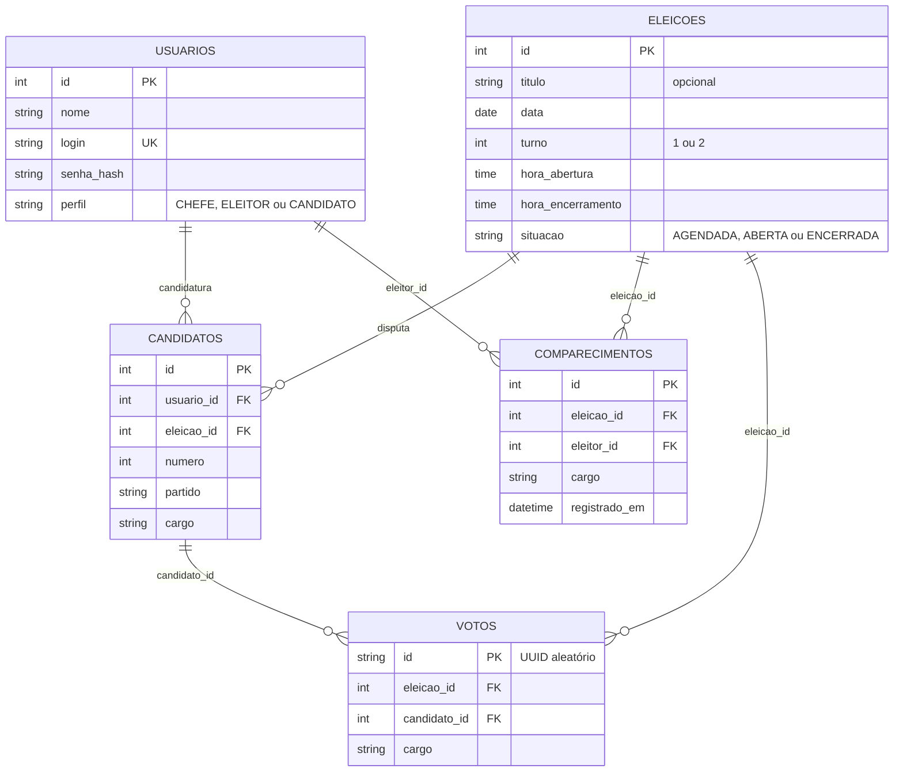

# Eleição Eletrônica — Back-End (FastAPI)

API do Sistema de Simulação de Eleição Eletrônica. Python 3.11+, FastAPI, SQLAlchemy 2, SQLite, JWT.

## Sumário

1. [Executar](#executar)
2. [Testes](#testes)
3. [Arquitetura](#arquitetura)
4. [Modularização](#modularização)
5. [Modelagem do banco de dados](#modelagem-do-banco-de-dados)
6. [Endpoints por perfil](#endpoints-por-perfil)
7. [Regras de negócio implementadas](#regras-de-negócio-implementadas)
8. [Sigilo do voto](#sigilo-do-voto)
9. [Erros](#erros)

## Executar

```bash
python -m venv .venv
source .venv/bin/activate          # Windows: .venv\Scripts\activate
pip install -r requirements.txt

python -m scripts.popular_demo      # dados de demonstração, caso deseje
uvicorn app.main:app --host 0.0.0.0 --port 8000 --reload
```

- Swagger UI: http://localhost:8000/docs  (ReDoc em `/redoc`, contrato em `/openapi.json`)
- Chefe da Seção criado automaticamente: **admin / admin123** (mude com `CHEFE_LOGIN`, `CHEFE_SENHA`).
- Para o app no celular, rode com `--host 0.0.0.0` e use o IP do computador (ex.: `http://192.168.0.10:8000`); libere a porta 8000 no firewall.
- Em Swagger: faça `POST /auth/login`, copie `access_token`, clique em **Authorize**.

Variáveis de ambiente: `DATABASE_URL` (padrão `sqlite:///./eleicao.db`), `SECRET_KEY`, `TOKEN_EXPIRE_MINUTES`.

## Testes

```bash
pytest           # 48 testes: 17 unitários (tests/unit) e 31 de integração (tests/integration)
```

- **Unitários** (`tests/unit/`): chamam funções e services direto, sem HTTP (hash de senha, JWT, schemas, regras de votação e apuração).
- **Integração** (`tests/integration/`): chamam a API real via `TestClient` (rota, perfil, regra de negócio e banco juntos), usando banco SQLite em memória.
- `tests/conftest.py` concentra as fixtures (banco limpo a cada teste, logins por perfil e um cenário pronto de eleição).

## Arquitetura

O sistema é uma API REST em **camadas**, em que cada camada só conversa com a imediatamente abaixo:

```
Cliente (Swagger UI, Postman/Insomnia, app Ionic)
        │  HTTP + JSON, token JWT no cabeçalho Authorization
        ▼
┌──────────────────────────────────────────────────────────────┐
│ main.py     app FastAPI, CORS, handler global de erros       │
├──────────────────────────────────────────────────────────────┤
│ routers/    camada HTTP: rotas, validação de entrada/saída   │
│             (schemas.py) e controle de perfil (deps.py)      │
├──────────────────────────────────────────────────────────────┤
│ services/   regras de negócio, sem nenhum conhecimento de    │
│             HTTP; lançam erros de negócio (exceptions.py)    │
├──────────────────────────────────────────────────────────────┤
│ models.py + database.py   tabelas e sessão (SQLAlchemy)      │
└──────────────────────────────────────────────────────────────┘
        ▼
     SQLite (trocável por outro banco via DATABASE_URL)
```

**Responsabilidade de cada camada**

| Camada | Responsabilidade | Não faz |
|---|---|---|
| `routers/` | Declara as rotas, valida o corpo da requisição com os schemas Pydantic, exige autenticação/perfil e delega ao service. Gera a documentação Swagger a partir de rotas, schemas e docstrings. | Não contém regra de negócio nem acessa tabelas diretamente. |
| `services/` | Aplica as regras (eleição só abre com candidatos, um voto por cargo, candidato só vê o próprio cargo etc.), consulta e grava no banco e confirma a transação. | Não conhece `Request`/`Response` nem códigos HTTP. |
| `models.py` | Mapeia as tabelas e restrições do banco. | Não tem lógica de negócio. |

**Fluxo de uma requisição (ex.: `POST /eleicoes/{id}/votos`)**

1. O **router** recebe o JSON e o valida com `VotoIn`.
2. A dependência `somente_eleitor` (`deps.py`) lê o JWT do cabeçalho (`security.ler_token`), carrega o usuário e confere o perfil. Sem token ou com token inválido a resposta é **401**; com perfil errado, **403**.
3. O **service** `votacao.votar` confere as regras (eleição ABERTA, voto confirmado, candidato da eleição) e grava `comparecimentos` e `votos` na **mesma transação**.
4. Se uma regra falhar, o service lança uma exceção de negócio (`Conflito`, `DadoInvalido`, `NaoEncontrado`...). O handler registrado em `main.py` converte em `{"detail": "mensagem"}` com o status correspondente (409, 422, 404...).

**Decisões de projeto**

- **Autenticação e perfis:** login retorna um JWT (HS256, expiração configurável). Senhas são guardadas como hash PBKDF2 com sal aleatório, comparadas em tempo constante; o login inexistente roda um hash fictício para o tempo de resposta não revelar quais logins existem.
- **Controle de acesso por dependência:** `exigir_perfil(...)` gera dependências reutilizáveis (`somente_chefe`, `somente_eleitor`); o acesso do CANDIDATO ao próprio cargo é verificado no service de apuração.
- **Erros centralizados:** os services lançam subclasses de `ErroNegocio`, cada uma com seu status HTTP; um único handler cuida da resposta.
- **Configuração por ambiente:** `config.py` lê variáveis de ambiente com padrões de desenvolvimento e a aplicação avisa no log se `SECRET_KEY` ou a senha do Chefe estiverem com o valor padrão.
- **Integridade no banco, não só no código:** regras críticas (voto único por cargo, número único de candidato) são restrições UNIQUE, que protegem inclusive contra requisições simultâneas.

## Modularização

```
app/
├── main.py        app, CORS, tratamento de erros, routers
├── config.py      configuração por variáveis de ambiente
├── database.py    engine/sessão SQLAlchemy (foreign keys ativadas no SQLite)
├── enums.py       Perfil, Situacao, Cargo e rótulos/ordem de exibição dos cargos
├── models.py      tabelas: usuarios, eleicoes, candidatos, comparecimentos, votos
├── schemas.py     contratos de entrada/saída (Pydantic → Swagger)
├── security.py    hash PBKDF2 e JWT
├── deps.py        usuário autenticado + controle por perfil (401/403)
├── exceptions.py  erros de negócio (401/403/404/409/422)
├── routers/       camada HTTP (auth, eleicoes, eleitores, candidatos, votacao, apuracao)
└── services/      regras de negócio (sem HTTP): usuarios, eleicoes, candidatos, votacao, apuracao
tests/ unit/ + integration/      scripts/popular_demo.py
```

**O que cada módulo faz**

| Módulo | Papel |
|---|---|
| `routers/auth.py` | `POST /auth/login`, `GET /auth/me` |
| `routers/eleicoes.py` | Cadastro, consulta, alteração, abertura e encerramento da eleição |
| `routers/eleitores.py` | CRUD de eleitores (só Chefe) |
| `routers/candidatos.py` | CRUD de candidatos (escrita só Chefe) |
| `routers/votacao.py` | Candidatos por cargo, cargos já votados e registro do voto (só Eleitor) |
| `routers/apuracao.py` | Apuração parcial e resultado final |
| `services/usuarios.py` | Autenticação, criação de usuários, CRUD de eleitores, criação do Chefe inicial |
| `services/eleicoes.py` | Ciclo AGENDADA → ABERTA → ENCERRADA e eleição em destaque |
| `services/candidatos.py` | CRUD de candidatos (cria o usuário CANDIDATO junto) |
| `services/votacao.py` | Regras do voto e do sigilo |
| `services/apuracao.py` | Contagem de votos, vencedor, empate e restrição de cargo do CANDIDATO |
| `enums.py` | Valores fixos compartilhados por modelos, schemas e services |
| `scripts/popular_demo.py` | Popula o banco com uma eleição, candidatos e eleitores de demonstração |

Cada router depende apenas do seu service, e cada service apenas dos models/schemas. Como os services não conhecem HTTP, os testes unitários os chamam diretamente.

## Modelagem do banco de dados

Banco relacional (SQLite por padrão) com **5 tabelas**, criadas por `Base.metadata.create_all` na inicialização. As colunas de enumeração (`perfil`, `situacao`, `cargo`) são gravadas como texto.



Não há ligação entre `COMPARECIMENTOS` e `VOTOS`: é proposital (veja [Sigilo do voto](#sigilo-do-voto)).

### Tabelas

**`usuarios`** — todos os perfis de acesso.

| Coluna | Tipo | Observação |
|---|---|---|
| `id` | inteiro, PK | |
| `nome` | texto (120) | |
| `login` | texto (60) | **único**, indexado |
| `senha_hash` | texto (300) | `pbkdf2$iterações$sal$hash`; a senha nunca é guardada nem devolvida |
| `perfil` | texto | `CHEFE`, `ELEITOR` ou `CANDIDATO` |

**`eleicoes`** — cada eleição (um turno).

| Coluna | Tipo | Observação |
|---|---|---|
| `id` | inteiro, PK | |
| `titulo` | texto (150) | opcional |
| `data` | data | |
| `turno` | inteiro | 1 ou 2 (validado na API) |
| `hora_abertura`, `hora_encerramento` | hora | encerramento depois da abertura (validado na API) |
| `situacao` | texto | `AGENDADA` (padrão), `ABERTA` ou `ENCERRADA` |

**`candidatos`** — candidatura de um usuário a um cargo em uma eleição.

| Coluna | Tipo | Observação |
|---|---|---|
| `id` | inteiro, PK | |
| `usuario_id` | inteiro, FK → `usuarios.id` | usuário de perfil CANDIDATO |
| `eleicao_id` | inteiro, FK → `eleicoes.id` | |
| `numero` | inteiro | número eleitoral (1 a 99999 na API) |
| `partido` | texto (40) | |
| `cargo` | texto | `DEPUTADO_ESTADUAL`, `DEPUTADO_FEDERAL`, `SENADOR`, `GOVERNADOR` ou `PRESIDENTE` |

Restrições: `UNIQUE (eleicao_id, cargo, numero)` — número único por cargo na eleição; `UNIQUE (eleicao_id, usuario_id)` — um usuário concorre uma única vez por eleição.

**`comparecimentos`** — controle de quem já votou em cada cargo.

| Coluna | Tipo | Observação |
|---|---|---|
| `id` | inteiro, PK | |
| `eleicao_id` | inteiro, FK → `eleicoes.id` | |
| `eleitor_id` | inteiro, FK → `usuarios.id` | |
| `cargo` | texto | |
| `registrado_em` | data e hora (UTC) | |

Restrição: `UNIQUE (eleicao_id, eleitor_id, cargo)` — **um voto por cargo**. Não guarda o candidato escolhido.

**`votos`** — votos anônimos.

| Coluna | Tipo | Observação |
|---|---|---|
| `id` | texto (32), PK | UUID aleatório em hexadecimal |
| `eleicao_id` | inteiro, FK → `eleicoes.id` | indexado |
| `candidato_id` | inteiro, FK → `candidatos.id` | indexado |
| `cargo` | texto | |

Sem eleitor e sem horário. A tabela é criada como `WITHOUT ROWID` (detalhes abaixo).

### Relacionamentos e integridade

- Uma eleição tem muitos candidatos; um usuário pode ter candidaturas em eleições diferentes.
- `foreign_keys` é ativado em cada conexão SQLite (`PRAGMA foreign_keys=ON`), então o banco recusa referências inválidas.
- Ao excluir um eleitor, seus `comparecimentos` são removidos antes; os `votos` já computados permanecem, pois não apontam para ele.
- Ao excluir um candidato (só com a eleição AGENDADA), o usuário correspondente também é removido se não tiver outra candidatura.
- O `create_all` não altera tabelas que já existem: se o `eleicao.db` foi criado antes de alguma mudança de modelo, apague-o e recrie.

## Endpoints por perfil

| Perfil | Pode |
|---|---|
| público | `POST /auth/login` |
| qualquer logado | `GET /auth/me`, `GET /eleicoes`, `/eleicoes/atual`, `/eleicoes/{id}`, `GET /candidatos` |
| **CHEFE** | `POST/PUT /eleicoes`, `POST /eleicoes/{id}/abrir`, `/encerrar`; CRUD `/eleitores`; `POST/PUT/DELETE /candidatos`; apuração/resultado de todos os cargos |
| **ELEITOR** | `GET /eleicoes/{id}/cargos`, `GET /eleicoes/{id}/meus-votos`, `POST /eleicoes/{id}/votos`; apuração/resultado de todos os cargos |
| **CANDIDATO** | `GET /eleicoes/{id}/apuracao` e `/resultado` **só do próprio cargo** |

Apuração: `GET /eleicoes/{id}/apuracao` (parcial, em tempo real; 409 se AGENDADA). Resultado final: `GET /eleicoes/{id}/resultado` (409 até encerrar; traz o mais votado de cada cargo, `empate: true` quando há empate no topo).

## Regras de negócio implementadas

- Eleição: `AGENDADA → ABERTA → ENCERRADA`, só o Chefe muda; turno 1 ou 2; encerramento depois da abertura; não abre sem candidatos.
- Voto só com eleição **ABERTA**, só **ELEITOR**, **um por cargo** (restrição UNIQUE no banco), exige `confirmado: true` e não pode ser alterado (não existe rota de edição/exclusão de voto).
- Candidatos só são criados/alterados/excluídos enquanto a eleição está AGENDADA; número único por cargo+eleição.
- Chefe cadastra eleitores e candidatos (candidato = usuário com cargo, partido, número e eleição).

## Sigilo do voto

`comparecimentos` guarda *que* o eleitor votou no cargo X (barra duplicidade); `votos` guarda eleição + candidato + cargo, com **UUID aleatório e sem eleitor nem horário**. Nenhuma tabela liga eleitor a candidato e nenhum endpoint revela em quem alguém votou (`meus-votos` só lista cargos).

A tabela `votos` é criada como **`WITHOUT ROWID`** no SQLite. Numa tabela comum, o `rowid` crescente guarda a ordem de inserção, e cruzar essa ordem com a de `comparecimentos` revelaria em quem cada eleitor votou. Sem rowid, os votos ficam ordenados só pelo UUID aleatório. Um banco `eleicao.db` criado antes dessa mudança precisa ser apagado e recriado, porque o `create_all` não altera tabelas que já existem.

Testes que garantem o sigilo e o controle de acesso (48 no total): colunas de `votos` e `comparecimentos`, `votos` como WITHOUT ROWID (consulta ao `sqlite_master`), token adulterado/expirado → 401, ELEITOR e CANDIDATO fora das rotas do Chefe e da votação → 403, CANDIDATO só vê o próprio cargo na apuração e no resultado.

## Erros

Formato `{"detail": "mensagem"}`: 401 credencial/token inválido, 403 perfil sem permissão, 404 não encontrado, 409 conflito (eleição não aberta, voto duplicado, login/número repetido), 422 dados inválidos.
